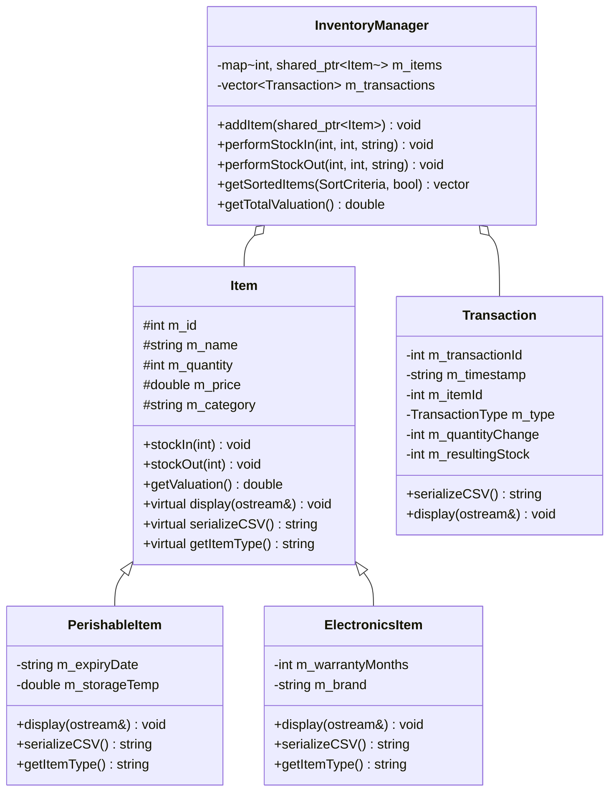

# Practical 12: Mini Project — Console-Based Application

## Topic Selected: Option B — Inventory Manager

---

### 1. Aim
To apply core Object-Oriented Programming (OOP) concepts, the C++ Standard Template Library (STL), structured exception handling, and robust file I/O within a complete, real-world console application developed using Git version control.

---

### 2. Problem Definition & Target Users

#### Target Users:
- **Warehouse Supervisors:** Perform batch stock-in replenishments and dispatches.
- **Retail Store Managers:** Track multiple item categories (standard merchandise, perishables with expiry dates, electronics with warranties) and monitor low-stock thresholds.
- **Inventory Auditors:** Require an immutable, chronological audit trail of all transactions to prevent shrinkage and verify stock balance history.

#### Problem Solved:
Spreadsheets and manual ledgers lack strict runtime invariant checks. They allow fatal mistakes such as:
1. **Negative Stock Counts:** Dispatching goods when stock is zero or insufficient, leading to severe logistical errors.
2. **Untyped Items:** Inability to handle category-specific constraints (e.g. storage temperature for perishables or warranty periods for electronics).
3. **Silent Errors & Data Loss:** Lack of file validation or transaction tracking.

This application solves these issues by enforcing strict domain constraints via custom C++ exceptions, polymorphism, STL map/vector containers, and CSV persistence.

---

### 3. OOP Concepts Demonstrated

| OOP Concept | Implementation in Code |
| :--- | :--- |
| **Encapsulation** | All member variables in `Item`, `PerishableItem`, `ElectronicsItem`, and `Transaction` are protected or private. Access is mediated via getters and validated setters (`setPrice`, `setName`, `stockIn`, `stockOut`). |
| **Constructors** | Parameterized constructors with member initializer lists enforce non-null values, non-negative prices, and positive IDs on object instantiation. |
| **Inheritance** | Base class `Item` is extended by `PerishableItem` (adding `m_expiryDate`, `m_storageTemp`) and `ElectronicsItem` (adding `m_warrantyMonths`, `m_brand`). |
| **Runtime Polymorphism** | Virtual functions `getItemType()`, `display()`, `serializeCSV()`, and `getDetails()` with dynamic dispatch via `std::shared_ptr<Item>`. Virtual destructor ensures safe polymorphic deallocation. |

---

### 4. STL Containers & Algorithms Used

1. **`std::map<int, std::shared_ptr<Item>>`**:
   - Stores inventory keyed by unique `id`.
   - Offers $O(\log N)$ search, insertion, and deletion while automatically maintaining sorted order.
2. **`std::vector<Transaction>`**:
   - Stores the chronological sequence of stock operations (audit log).
3. **`std::vector<std::shared_ptr<Item>>`**:
   - Houses dynamically filtered query results without object slicing.
4. **`std::sort`**:
   - Powers the multi-criteria sorting engine with custom lambdas (sort by ID, Name, Price, Quantity in Ascending or Descending order).
5. **`std::accumulate`**:
   - Computes total portfolio valuation ($\sum \text{quantity} \times \text{price}$) and total physical unit count.
6. **`std::transform`**:
   - Powers case-insensitive search by converting search strings and item names to lowercase.

---

### 5. Exception Handling Strategy

A custom hierarchy inheriting from `std::runtime_error`:
- **`DuplicateItemException`**: Prevents adding an item whose ID already exists.
- **`ItemNotFoundException`**: Triggered when accessing or modifying a non-existent item.
- **`InsufficientStockException`**: **Guarantees negative stock cannot occur**. Thrown when `dispatch_quantity > available_quantity`.
- **`InvalidInputException`**: Thrown when negative prices, empty names, or invalid numbers are supplied.
- **`FileStorageException`**: Traps file missing, permissions, or disk write failures.

---

### 6. UML Class Diagram



---

### 7. Verification & Output Evidence

#### Normal Execution Cases:
- **Case 1 (Load Records):** 9 items and 10 transactions loaded from CSV.
- **Case 2 (View Catalogue):** Displays items with category-specific attributes (Expiry dates and temperatures for dairy, warranties and brands for electronics).
- **Case 3 (Stock-In):** Item 302 replenished by +12 units (Stock: 8 $\to$ 20).
- **Case 4 (Stock-Out):** Item 301 dispatched by 5 units (Stock: 30 $\to$ 25).
- **Case 5 (Search & Filter):** Case-insensitive search finds 3 dairy items.
- **Case 6 (Low Stock Alert):** Items with $\le 5$ units flagged for reorder.
- **Case 7 (Persistence):** Exported and reloaded cleanly.

#### Error & Exception Cases:
- **Error Case 1 (Negative Stock Prevention):**
  - Attempt: Dispatch 14 units of Item ID 103 (Stock: 4).
  - Result: `InsufficientStockException` caught: `"Error: Insufficient stock for Item ID 103. Requested: 14, Available: 4. Operation aborted to prevent negative stock."`
- **Error Case 2 (Duplicate ID):**
  - Attempt: Add item with existing ID 101.
  - Result: `DuplicateItemException` caught: `"Error: Item with ID 101 already exists in inventory."`
- **Error Case 3 (Item Not Found):**
  - Attempt: Query item ID 9999.
  - Result: `ItemNotFoundException` caught: `"Error: Item with ID 9999 not found."`
- **Error Case 4 (Domain Invariant Check):**
  - Attempt: Set price to $-\$50.00$.
  - Result: `InvalidInputException` caught: `"Validation Error: Price cannot be negative."`

---

### 8. Instructions to Push to GitHub

To submit this project to your GitHub account:
```bash
# 1. Create a new repository on https://github.com/new (e.g., named 'inventory-manager-cpp')
# 2. In your terminal, link and push:
git remote add origin https://github.com/<your-username>/inventory-manager-cpp.git
git branch -M main
git push -u origin main
```
