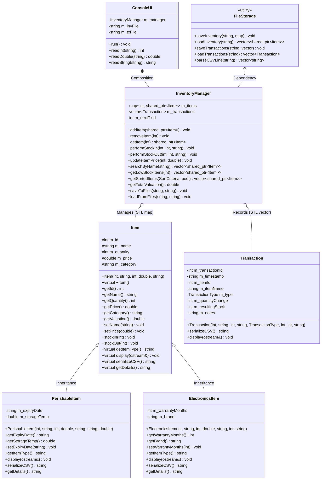

# Practical 12 | Mini Project: Console-Based Inventory Management System

**Course:** Object-Oriented Programming (OOP) & Standard Template Library (STL)  
**Option Selected:** **OPTION B — INVENTORY MANAGER**  
**Language:** C++ (C++14 Standard)  
**Compiler Support:** MinGW GCC 6.3+, MSVC, Clang, GCC 7+  

---

## 1. Project Overview & Problem Definition

### 1.1 Target Users
- **Warehouse Supervisors & Stock Clerks:** Need fast, real-time inventory adjustments during goods intake and dispatch.
- **Small-to-Medium Retailers & Store Managers:** Manage diverse item categories (general merchandise, fresh perishables, electronics) and track replenishment thresholds.
- **Procurement & Auditing Teams:** Require immutable transaction logs to track stock history and prevent inventory leakage.

### 1.2 The Problem
Traditional manual stock management or unstructured spreadsheets suffer from critical drawbacks:
1. **Accidental Negative Stock:** Clerical oversights result in negative stock balances, causing supply chain miscalculations.
2. **Lack of Category-Specific Attributes:** General goods, perishable foodstuffs (expiry dates, cold-chain temperatures), and electronics (warranties, brands) have distinct operational needs that flat databases cannot cleanly handle.
3. **Absence of Transaction Auditing:** Updates occur without an audit trail, making it impossible to determine who changed stock, when, and why.
4. **Data Corruption & Fragility:** Lack of data validation permits negative prices, blank item names, and duplicate item IDs.

### 1.3 The Solution
This **Console-Based Inventory Management System** is a robust, modular C++ application designed strictly around core OOP principles, modern STL containers, explicit exception safety, and CSV file persistence. It provides:
- Categorical item modeling via **Inheritance and Runtime Polymorphism**.
- Guaranteed prevention of negative stock via **Custom Exception Handling**.
- High-efficiency lookup, sorting, and reporting using **STL Containers & Algorithms**.
- Full **CSV-based persistence** for both catalog items and transaction audit trails.

---

## 2. Object-Oriented Architecture & Design

### 2.1 Encapsulation
All attributes are protected or private. State changes can only happen through validated member functions:
- `stockIn(int amount)`: Requires `amount > 0`.
- `stockOut(int amount)`: Requires `amount > 0` and `amount <= m_quantity`. If `amount > m_quantity`, throws `InsufficientStockException`.
- `setPrice(double price)`: Rejects negative values via `InvalidInputException`.
- `setName(string name)`: Rejects empty or whitespace-only strings.

### 2.2 Class Hierarchy & Responsibilities



---

## 3. Standard Template Library (STL) Integration

| STL Component | Usage in Project | Benefit / Rationale |
| :--- | :--- | :--- |
| `std::map<int, std::shared_ptr<Item>>` | In-memory item storage keyed by unique `id`. | Guarantees $O(\log N)$ search, insertion, and deletion; enforces unique IDs; keeps catalogue naturally sorted. |
| `std::vector<Transaction>` | Audit trail history. | Dynamic, contiguous array optimized for sequential appending of immutable audit records. |
| `std::vector<std::shared_ptr<Item>>` | Query results (search, filter, sort). | Enables polymorphic object passing via smart pointers without object slicing. |
| `std::sort` | Inventory sorting menu. | Custom lambda predicates sort by ID, Name, Price, or Stock Quantity in $O(N \log N)$ time. |
| `std::accumulate` | Aggregate statistics. | Calculates total inventory monetary valuation ($\sum \text{qty} \times \text{price}$) and total physical units in stock. |
| `std::transform` | Case-insensitive search. | Converts user query and item strings to lowercase for seamless partial substring matching. |
| `std::shared_ptr<Item>` | Memory lifecycle management. | Automatic reference counting prevents memory leaks and double-free issues when handling polymorphic base pointers. |

---

## 4. Exception Handling Strategy

The system defines an expressive hierarchy inheriting from `std::runtime_error`:

```
std::exception
  └── std::runtime_error
        └── InventoryException (Base for application)
              ├── DuplicateItemException     (Thrown when adding an existing ID)
              ├── ItemNotFoundException      (Thrown when ID is absent)
              ├── InsufficientStockException (Thrown when dispatch > available stock)
              ├── InvalidInputException      (Thrown on negative price/stock, blank fields)
              └── FileStorageException       (Thrown on CSV open/write/read failure)
```

### Prevention of Negative Stock
The critical requirement **"prevent negative stock quantities"** is enforced directly inside `Item::stockOut`:
```cpp
void Item::stockOut(int amount) {
    if (amount <= 0) {
        throw InvalidInputException("Stock-out quantity must be strictly greater than zero.");
    }
    if (amount > m_quantity) {
        throw InsufficientStockException(m_id, amount, m_quantity);
    }
    m_quantity -= amount;
}
```
If an operator attempts to dispatch more units than exist, the subtraction never executes, the state remains intact, and an `InsufficientStockException` is caught and displayed by the UI.

---

## 5. File Persistence & CSV Format

The application stores data in standard comma-separated value files in `data/`.

### 5.1 `inventory.csv` Schema
```csv
Type,ID,Name,Quantity,Price,Category,Extra1,Extra2
Standard,101,"Heavy Duty Stapler",45,12.50,"Stationery",N/A,N/A
Perishable,201,"Organic Whole Milk 1L",25,2.40,"Dairy","2026-11-28",4.0
Electronics,301,"Logitech Wireless Mouse",30,29.99,"Peripherals",24,"Logitech"
```
- **Polymorphic deserialization:** `FileStorage::loadInventory` inspects column 0 (`Type`). If `Perishable`, it reconstructs `PerishableItem`; if `Electronics`, it reconstructs `ElectronicsItem`; otherwise standard `Item`.
- **Quote-safety:** `parseCSVLine()` correctly handles commas embedded inside quoted strings (e.g., `"A4 Printing Paper, Premium"`).

### 5.2 `transactions.csv` Schema
```csv
TxID,Timestamp,ItemID,ItemName,Type,QuantityChange,ResultingStock,Notes
1,"2026-11-15 09:00:00",101,"Heavy Duty Stapler",INITIAL,45,45,"Initial stock intake"
2,"2026-11-16 10:30:00",102,"A4 Printing Paper (Ream)",STOCK_IN,20,120,"PO #4419 received"
3,"2026-11-17 14:10:00",101,"Heavy Duty Stapler",STOCK_OUT,-5,40,"Office supply dispatch"
```

---

## 6. Project Structure

```
oop/
├── .gitignore               # Git ignore rules for binaries and temporary files
├── Makefile                 # Make build script for Unix/Linux/MinGW
├── build.bat                # 1-Click build script for Windows
├── run.bat                  # 1-Click run script for interactive console app
├── test.bat                 # 1-Click test script for automated test runner
├── README.md                # Complete documentation, architecture, and manual
├── include/                 # Header declarations
│   ├── Exceptions.hpp       # Custom exception hierarchy
│   ├── Item.hpp             # Base Item class
│   ├── PerishableItem.hpp   # Perishable goods derived class
│   ├── ElectronicsItem.hpp  # Electronics goods derived class
│   ├── Transaction.hpp      # Audit trail model
│   ├── FileStorage.hpp      # CSV serialization and deserialization
│   ├── InventoryManager.hpp # STL business logic container
│   └── ConsoleUI.hpp        # Interactive text-based menu interface
├── src/                     # Source implementations
│   ├── Item.cpp
│   ├── PerishableItem.cpp
│   ├── ElectronicsItem.cpp
│   ├── Transaction.cpp
│   ├── FileStorage.cpp
│   ├── InventoryManager.cpp
│   ├── ConsoleUI.cpp
│   └── main.cpp             # Application entry point
├── data/                    # Data storage directory
│   ├── inventory.csv        # Persistent inventory records
│   └── transactions.csv     # Persistent transaction log
└── tests/                   # Automated verification suite
    └── demo_runner.cpp      # Standalone verification runner
```

---

## 7. How to Compile & Run

### 7.1 Running as Interactive Web Application (Modern Dashboard)
The project includes a full-featured web dashboard backed directly by the CSV database:
1. Double-click or run:
   ```cmd
   start_website.bat
   ```
2. Or run via Node.js:
   ```bash
   node server.js
   ```
3. Open your browser at **`http://localhost:3000`**.  
   *Features included:* Live inventory table, instant search & multi-criteria sorting, quick stock-in/stock-out modals, dynamic negative stock protection checks, low-stock reorder warnings, transaction audit trail, and UML architecture visualizer.

---

### 7.2 Running as C++ Console Application
### Prerequisites
- GCC / MinGW (`g++` supporting C++14 or higher) or Clang or MSVC.

### Windows (Quick 1-Click Scripts)
1. **To Build Console Binary:**
   ```cmd
   build.bat
   ```
2. **To Run Interactive Console App:**
   ```cmd
   run.bat
   ```
3. **To Run Automated Test Suite & Demo:**
   ```cmd
   test.bat
   ```

### Manual Command Line (MinGW / GCC)
```bash
# Build main application
g++ -std=c++14 -Iinclude src/*.cpp -o bin/inventory_app.exe

# Run application
bin/inventory_app.exe

# Build and run verification test suite
g++ -std=c++14 -Iinclude src/Item.cpp src/PerishableItem.cpp src/ElectronicsItem.cpp src/Transaction.cpp src/FileStorage.cpp src/InventoryManager.cpp tests/demo_runner.cpp -o bin/demo_runner.exe
bin/demo_runner.exe
```

---

## 8. Verification & Demonstration Output

The automated test suite (`tests/demo_runner.cpp`) validates both normal operational flows and critical edge/error scenarios.

### 8.1 Normal Case Demonstrations

```text
========================================================================================
  PRACTICAL 12: INVENTORY MANAGER - AUTOMATED DEMONSTRATION & VERIFICATION
========================================================================================

>>> NORMAL CASE 1: Load Existing Inventory Records from CSV
[PASS] Successfully loaded 9 items and 10 transactions.

>>> NORMAL CASE 2: Display All Items (Polymorphic Output & Statistics)
ID    Item Name             Type        Category         Stock   Price ($) Total Val ($)  Additional Details
--------------------------------------------------------------------------------------------
101   Heavy Duty Stapler    Standard    Stationery          45       12.50        562.50  -
102   A4 Printing Paper...  Standard    Stationery         120        5.75        690.00  -
103   Ergonomic Office ...  Standard    Furniture            4      149.50        598.00  -
201   Organic Whole Mil...  Perishable  Dairy               25        2.40         60.00  Exp: 2026-11-28 | Temp: 4.0C
202   Fresh Greek Yogurt    Perishable  Dairy               14        3.20         44.80  Exp: 2026-12-05 | Temp: 3.5C
203   Artisan Cheddar C...  Perishable  Dairy                6        7.50         45.00  Exp: 2026-12-20 | Temp: 5.0C
301   Logitech Wireless...  Electronics Peripherals         30       29.99        899.70  Warranty: 24 mos | Brand: Logitech
302   Dell 24-inch IPS ...  Electronics Monitors             8      179.99       1439.92  Warranty: 36 mos | Brand: Dell
303   Anker USB-C Hub 7...  Electronics Accessories          3       45.00        135.00  Warranty: 18 mos | Brand: Anker
--------------------------------------------------------------------------------------------
Total Item Types: 9 | Total Units: 255 | Total Portfolio Value: $4474.92

>>> NORMAL CASE 3: Add New Polymorphic Items (Standard, Perishable, Electronics)
[PASS] Added PerishableItem (ID 204: 'Flu Vaccine Doses').
[PASS] Added ElectronicsItem (ID 304: 'Mechanical Keyboard RGB').

>>> NORMAL CASE 4: Perform Stock-In (Replenish Inventory)
[PASS] Stock-In successful for Item ID 302. Quantity: 8 -> 20 (+12)

>>> NORMAL CASE 5: Perform Stock-Out (Dispatch Goods)
[PASS] Stock-Out successful for Item ID 301. Quantity: 30 -> 25 (-5)

>>> NORMAL CASE 6: Search Items (By ID & Keyword 'Dairy')
Found 3 matching items in Dairy:
  - ID 201: Organic Whole Milk 1L ($2.40, Stock: 25)
  - ID 202: Fresh Greek Yogurt ($3.20, Stock: 14)
  - ID 203: Artisan Cheddar Cheese ($7.50, Stock: 6)

>>> NORMAL CASE 7: Low Stock Alerts (Threshold <= 5)
Items needing replenishment (2 items found):
  [ALERT] ID 103 'Ergonomic Office Chair' has only 4 units left!
  [ALERT] ID 303 'Anker USB-C Hub 7-in-1' has only 3 units left!

>>> NORMAL CASE 8: Sort Catalog (By Price Descending)
Top 3 highest value items:
  1. Dell 24-inch IPS Monitor @ $179.99
  2. Ergonomic Office Chair @ $149.50
  3. Mechanical Keyboard RGB @ $89.90

>>> NORMAL CASE 9: File Persistence (Save & Reload Verification)
[PASS] Saved records to temporary files.
[PASS] Reloaded successfully from temporary files (11 items, 14 transactions).
```

### 8.2 Error Case Demonstrations

```text
========================================================================================
  PART 2: EXCEPTION HANDLING & ERROR CASE VERIFICATION
========================================================================================

>>> ERROR CASE 1: Prevent Negative Stock (InsufficientStockException)
Attempting to dispatch 14 units of ID 103 (Available: 4)...
[CAUGHT EXPECTED EXCEPTION] InsufficientStockException:
   --> Error: Insufficient stock for Item ID 103. Requested: 14, Available: 4. Operation aborted to prevent negative stock.
[PASS] Stock was successfully protected against negative value.

>>> ERROR CASE 2: Duplicate Item ID Detection (DuplicateItemException)
Attempting to add new item with already existing ID 101...
[CAUGHT EXPECTED EXCEPTION] DuplicateItemException:
   --> Error: Item with ID 101 already exists in inventory.
[PASS] Duplicate item rejected cleanly.

>>> ERROR CASE 3: Item Not Found (ItemNotFoundException)
Attempting to query non-existent ID 9999...
[CAUGHT EXPECTED EXCEPTION] ItemNotFoundException:
   --> Error: Item with ID 9999 not found.
[PASS] Non-existent item properly handled.

>>> ERROR CASE 4: Invalid Domain Values (InvalidInputException)
Attempting to create item with negative price (-50.00)...
[CAUGHT EXPECTED EXCEPTION] InvalidInputException:
   --> Validation Error: Price cannot be negative.
[PASS] Domain constraints strictly enforced.

>>> ERROR CASE 5: File I/O Error Handling (FileStorageException)
Attempting to load from an invalid non-existent path 'data/invalid_dir/no_file.csv'...
[CAUGHT EXPECTED EXCEPTION] FileStorageException:
   --> File I/O Error on 'data/invalid_dir/no_file.csv': File not found or cannot be opened for reading.
[PASS] File I/O failures gracefully trapped.

========================================================================================
  ALL DEMONSTRATION TESTS COMPLETED SUCCESSFULLY (100% PASS)
========================================================================================
```

---

## 9. Git Commit Progression

This project followed a staged, test-driven commit workflow:

```text
* 713d931 - feat: Add sample CSV data, build scripts, Makefile, and automated test suite
* 253a611 - feat: Implement ConsoleUI and interactive main entry point
* e336b45 - feat: Implement InventoryManager core logic with STL containers and algorithms
* f6c266b - feat: Implement FileStorage for CSV persistence and error handling
* 929753b - feat: Implement Transaction audit log model
* 590cfb9 - feat: Implement Item base class and derived classes (PerishableItem, ElectronicsItem)
* 8521bb7 - feat: Implement custom exception hierarchy (Exceptions.hpp)
* c7eccc1 - chore: Initial repository setup and .gitignore
```

---

## 10. Conclusion & Learning Outcomes
Through Practical 12, the following core software engineering and OOP competencies were integrated into a practical application:
1. **Encapsulation & State Invariants:** Protected private attributes with strict setter and stock-adjustment validation.
2. **Inheritance & Runtime Polymorphism:** Specialized `Item` into `PerishableItem` and `ElectronicsItem`, enabling dynamic dispatch for custom displays and CSV serialization.
3. **STL Power:** Employed `std::map`, `std::vector`, smart pointers (`std::shared_ptr`), and algorithms (`std::sort`, `std::accumulate`, `std::transform`) to write clean, idiomatic C++.
4. **Exception Safety:** Replaced fragile return codes with dedicated, expressive custom exceptions that preserve state integrity and eliminate negative inventory counts.
5. **Data Persistence:** Built robust, quotation-aware CSV persistence to save and reload state across application restarts.
6. **Git Version Control:** Maintained an atomic, communicative commit history documenting each design milestone.
